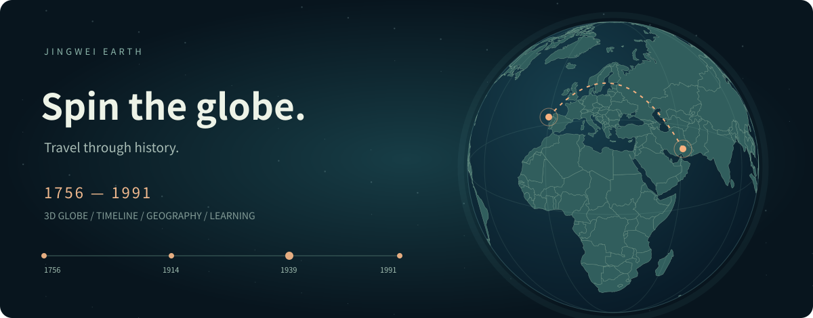

<div align="center">

# Jingwei Earth · 经纬

### Spin the globe. Travel through history.

**An interactive 3D globe for exploring world geography and modern war history.**

[Live demo](https://jasirvoriya.github.io/jingwei-earth/) · [中文](README.md) · [Contributing](CONTRIBUTING.md) · [Report an issue](https://github.com/JasirVoriya/jingwei-earth/issues)



</div>

What would you see if you moved a timeline to **1942**, then spun the Earth?

Europe, North Africa and the Pacific appear in the same space. Select an event, read the annual context, follow a schematic movement arc, then advance a year. Jingwei Earth connects places and dates so that history becomes easier to explore and remember.

**The app interface and study content are currently in Chinese.** This English guide introduces the project; full English UI localization is not yet available.

## Explore

- **A globe you can move:** drag to rotate; scroll or pinch to zoom; select countries and geographic features.
- **A timeline you can play:** scrub 1756–1991, play at 1× / 2× / 4×, or focus on one conflict.
- **Annual historical layers:** current-year events, muted earlier nodes, political/armistice events and animated direction arcs. Future events stay off the globe.
- **Geography with context:** connect straits, rivers, mountains and oceans to transportation, distance and supply.
- **A personal learning notebook:** bookmarks, completed-topic tracking and 12 questions with explanations, stored locally in your browser.

The current collection includes **19 representative conflicts, 177 country/territory map units and 17 geography notes**. WWI, WWII and the Korean War have expanded annual narratives; coverage is deliberately limited and source-linked.

## Try it in three minutes

1. Open the [demo](https://jasirvoriya.github.io/jingwei-earth/).
2. Select WWII, focus the timeline and jump to 1942.
3. Enable direction lines and camera following, then press play.
4. Switch to geography mode and explore the Suez Canal.
5. Try a quiz question, then return to the globe to review the place.

## Run locally

No framework installation, build step, backend, database or API key required. Map data, Three.js and learning content are bundled in the repository. No runtime JavaScript CDN dependency.

```bash
git clone https://github.com/JasirVoriya/jingwei-earth.git
cd jingwei-earth
python3 -m http.server 8080 --directory dist
```

Open **http://localhost:8080**. Any static HTTP server works. Do not open `index.html` directly via `file://`: ES modules require an HTTP context in common browsers.

## Controls

| Action | Mouse or touch | Keyboard after focusing the globe |
| --- | --- | --- |
| Rotate | Drag | Arrow keys |
| Zoom | Scroll, pinch or +/− buttons | + / − |
| Reset view | Home-shaped button | Home |
| Change year | Timeline slider or year chips | Focus slider, then use arrow keys |
| Explore a label | Click | Tab, then Enter |

## Under the hood

Vanilla HTML/CSS/JavaScript with ES modules. Three.js r170 renders the WebGL globe; a Canvas software sphere is used when WebGL cannot initialize. Both paths share geographic coordinates and annual event state. The fallback uses an orthographic sphere projection and capped raster resolution.

- `dist/app.js`: application interactions and learning state.
- `dist/globe.js` / `dist/globe-canvas.js`: renderers and animations.
- `dist/globe-math.mjs`: spherical coordinates and great-circle arcs.
- `dist/content.js` / `dist/campaigns.js`: sourced learning content.
- `dist/map-data.js`: Natural Earth geometry.
- `tests/`: data and core-logic tests.

Bookmarks, completed topics and best quiz score use localStorage. They do not sync between devices. The app respects reduced-motion preferences and includes a mobile layout.

## Test and deploy

With Node.js 20+:

```bash
node --test tests/*.test.mjs
```

The 13 checks cover data integrity, filters, coordinates, quiz references, dateline/antipodal arcs and annual state selection. GitHub Actions tests pushes and pull requests, then deploys `dist/` from `main` to GitHub Pages. Forks should enable **Settings → Pages → Source: GitHub Actions** before deploying.

Browser QA covered the software renderer and desktop/mobile interactions. The QA browser disabled WebGL, so the GPU renderer has not been visually verified there. Physical multitouch devices need further testing.

## Historical and geographic limits

This is an educational starting point, not an exhaustive conflict database or a historical territorial reconstruction.

- Annual views aggregate a whole year; they are not exact day-by-day snapshots.
- Direction arcs are illustrative, not precise troop tracks, front lines or control areas.
- Modern boundaries and highlighted regions help locate events; they do not describe historical borders or complete belligerent membership.
- Animation speed and marker size do not encode casualties or intensity.
- Small states/islands may be absent from the low-resolution map; capital labels can be incomplete or dated.
- Source URLs are available in the app and content files. Historical interpretations and periodization can differ.

## Contribute

Corrections, sources, accessibility improvements and new study topics are welcome in English or Chinese. See [CONTRIBUTING.md](CONTRIBUTING.md). For history additions, include a reliable source, year, location and a clear distinction between documented facts and illustrative geometry.

Possible future directions include more regional coverage, month-level stages, sourced historical boundaries and localization. These are ideas, not shipped features.

## License and credits

Original project code and documentation: [MIT](LICENSE). Three.js and OrbitControls retain their [MIT license](dist/vendor/THREE-LICENSE.txt). [Natural Earth](https://www.naturalearthdata.com/about/terms-of-use/) map data is public domain, retrieved on 2026-10-25. Source-linked historical pages retain their respective rights.

---

**Understand time through space. Remember the world through connections.**
